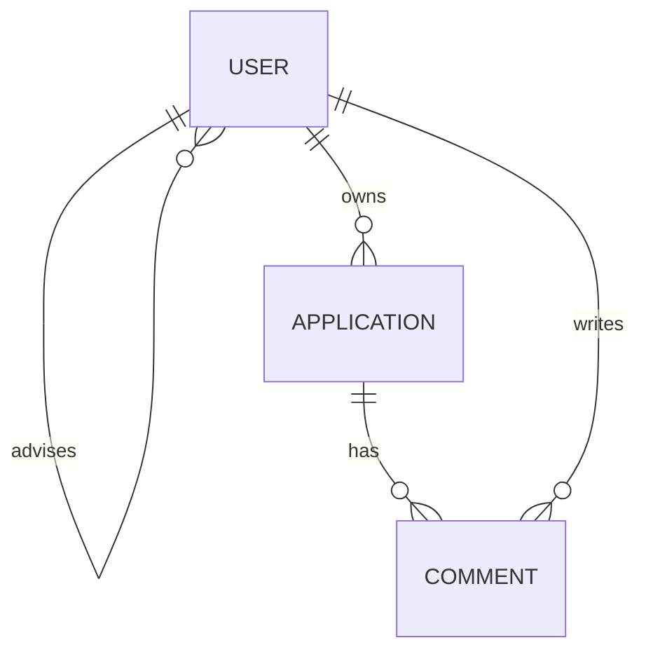
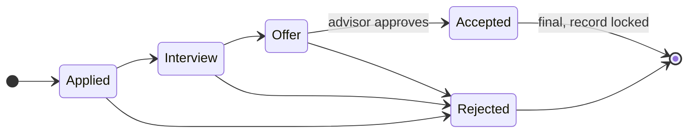

# Project Proposal: Student Internship Tracker

**Student:** PUM BRUSMUNY · **ID:** e20230959

Internet Programming I · I4-GIC-B · ITC · 2026–2027 · Mr. CHUN Thavorac · 21 October 2026

---

## 1. Introduction

I propose to build **Student Internship Tracker**, a web application where students record their internship applications and advisors follow, comment on and approve them. It is my individual project for Internet Programming I (I4-GIC-B, ITC, 2026–2027), selected from the official course domain list.

### 1.1 Problem

I4 students apply to multiple internship companies at once and track them across fragmented personal notes and chat messages, leading to lost advisor feedback and unmonitored statuses. Without a centralized tracking and approval platform, academic advisors cannot effectively oversee student progress or verify and approve offers before students commit.

### 1.2 Purpose and scope

The app gives each student one private list of their applications, with a clear status workflow, an attached CV, and an advisor's comments and approval. In scope:

- Account registration and login for two roles: Student and Advisor
- Create, view, edit and delete internship applications
- A fixed status workflow from Applied to Accepted or Rejected
- Advisor comments on an application, and advisor approval of an offer
- Search, filter by status and pagination on the application list
- CV upload (PDF) on an application

### 1.3 Definitions

| Term               | Meaning                                                                           |
| ------------------ | --------------------------------------------------------------------------------- |
| Application        | One internship a student applied for: company, position, date, status             |
| Status             | The stage of an application: Applied, Interview, Offer, Accepted, Rejected        |
| Advisor            | A teacher who follows a group of students and approves offers                     |
| Active application | An application in Applied, Interview or Offer status                              |
| JWT                | JSON Web Token, used to keep a user logged in                                     |
| IDOR               | Insecure Direct Object Reference: reading another user's record by changing an id |

### 1.4 Technology stack

The stack is fixed by the course: **Vue 3 + TypeScript** (Vite, Vue Router, Pinia) for the frontend, **NestJS 12** for the backend API, and **PostgreSQL 18 with Prisma** for the database. Tests use Vitest (frontend) and Jest + Supertest (backend).

## 2. Overall description

The system is a standalone web app: a Vue single-page app talks to a NestJS REST API, which stores data in PostgreSQL through Prisma.

### 2.1 User roles

| Role    | Who                                       | What they can do                                                                                                   |
| ------- | ----------------------------------------- | ------------------------------------------------------------------------------------------------------------------ |
| Student | An I4 student looking for an internship   | Register, log in, manage only their own applications, upload a CV, read advisor comments, accept an approved offer |
| Advisor | A teacher who follows a group of students | Log in, see the applications of their assigned students, comment, approve an offer                                 |

Advisor accounts are created by the seed script, not by public registration. Public registration always creates a Student. The seed creates at least one advisor and two students, each linked to an advisor.

### 2.2 Operating environment

- Runs in a current desktop browser (Chrome, Firefox, Edge); usable on a phone-width screen
- Backend: Node.js 22 LTS or newer, NestJS 12; database: PostgreSQL 18 or newer
- Development: run locally with `npm run dev` (frontend) and `npm run start:dev` (backend)

### 2.3 Constraints

- Stack fixed by the course: Vue 3 + TypeScript, NestJS, PostgreSQL with Prisma
- Individual project, built step by step over 7 score checks (weeks 4 to 16)
- Every AI use is logged in `AI_LOG.md`; I must be able to explain every line
- Code lives in a private GitHub repository `ip1-<student-id>` shared with the teacher

### 2.4 Assumptions

- Each student has exactly one advisor, set by the seed data
- Company is a text field on the application, not a separate managed list
- No real email is sent; notifications are out of scope

## 3. Data model

The app has three main entities, **User**, **Application** and **Comment**, linked by four one-to-many relations.

### 3.1 Relations

- One **Advisor** (User) has many **Students** (User), through `advisorId`
- One **Student** has many **Applications**
- One **Application** has many **Comments**
- One **User** writes many **Comments** (as author)

### 3.2 Entities

#### User

| Field        | Type     | Notes                                          |
| ------------ | -------- | ---------------------------------------------- |
| id           | Int      | Primary key                                    |
| email        | String   | Unique, used to log in                         |
| passwordHash | String   | bcrypt hash; never returned by the API         |
| fullName     | String   | Required                                       |
| role         | Enum     | `STUDENT` or `ADVISOR`                         |
| advisorId    | Int?     | Set for students only; points to their advisor |
| createdAt    | DateTime | Set by the database                            |

#### Application

| Field                | Type      | Notes                                                   |
| -------------------- | --------- | ------------------------------------------------------- |
| id                   | Int       | Primary key                                             |
| studentId            | Int       | Owner of the application                                |
| company              | String    | Required, 2–100 characters                              |
| position             | String    | Required, 2–100 characters                              |
| appliedAt            | Date      | Required, not in the future                             |
| status               | Enum      | `APPLIED`, `INTERVIEW`, `OFFER`, `ACCEPTED`, `REJECTED` |
| notes                | String?   | Optional, max 1000 characters                           |
| cvFileName           | String?   | Stored PDF file name, set by the CV upload              |
| approvedById         | Int?      | Advisor who approved the offer                          |
| approvedAt           | DateTime? | When the offer was approved                             |
| createdAt, updatedAt | DateTime  | Set by Prisma                                           |

#### Comment

| Field         | Type     | Notes                               |
| ------------- | -------- | ----------------------------------- |
| id            | Int      | Primary key                         |
| applicationId | Int      | The application commented on        |
| authorId      | Int      | The advisor or student who wrote it |
| body          | String   | Required, 1–500 characters          |
| createdAt     | DateTime | Set by the database                 |

### 3.3 Status workflow

An application only moves forward. A student can reject it at any active stage, but can only accept an offer after their advisor approves it.

Approval is not a status. It is stored on the application (`approvedById`, `approvedAt`) and unlocks the move from Offer to Accepted.

## 4. Functional requirements

The app is defined by 10 user stories: 7 for students, 3 for advisors. Each acceptance criterion will become one automated test (Check 6).

### Student stories

**US-01 · Register and log in**
As a student, I want to create an account and log in, so that only I can see my applications.

- Registering with a new email and a password of at least 8 characters creates a Student account
- Registering with an email already in use shows "Email is already registered"
- Logging in with a wrong password shows "Invalid email or password" and does not say which one is wrong
- After login I land on my applications list; after logout, protected pages send me to the login page

**US-02 · Add an application**
As a student, I want to add an internship I applied for, so that I keep track of it.

- Company, position and date applied are required; status starts at Applied
- A missing company or position shows "Company is required" / "Position is required" under the field
- A date in the future shows "Date applied cannot be in the future"
- I cannot have more than 5 active applications; the 6th shows "You already have 5 active applications"

**US-03 · See my applications**
As a student, I want to see a list of my applications, so that I know where I stand.

- The list shows company, position, date applied and status, newest first
- I see only my own applications, never another student's
- Opening another student's application by its URL shows "Application not found"

**US-04 · Search, filter and page through my applications**
As a student, I want to search and filter my list, so that I find an application quickly.

- Typing in the search box filters by company or position (not case-sensitive)
- A status filter shows only applications with that status
- The list shows 10 applications per page with Previous / Next buttons

**US-05 · Edit or delete an application**
As a student, I want to update an application's details and status, so that it stays current.

- I can edit company, position, date and notes, and move the status one step forward (Applied → Interview → Offer) or to Rejected; Accepted is set only through US-07
- Moving the status backward shows "Status can only move forward"
- An accepted or rejected application cannot be edited or deleted, and an approved offer can only be accepted or rejected; the buttons are hidden and the API returns 403
- Deleting asks for confirmation and removes the application and its comments

**US-06 · Upload my CV**
As a student, I want to attach the CV I sent to an application, so that my advisor can review it.

- Only PDF files up to 2 MB are accepted
- Another file type shows "Only PDF files are allowed"; a larger file shows "File must be 2 MB or smaller"
- Uploading again replaces the previous CV; my advisor and I can download it

**US-07 · Accept an approved offer**
As a student, I want to accept an offer after my advisor approves it, so that my internship is confirmed.

- The Accept button appears only when status is Offer and the advisor has approved it
- Accepting before approval returns 403 and shows "Your advisor must approve this offer first"
- After accepting, status is Accepted and the record is locked

### Advisor stories

**US-08 · See my students' applications**
As an advisor, I want to see the applications of the students I follow, so that I know who needs help.

- The list shows student name, company, position and status, with the same search, filter and pagination as US-04
- I see only my assigned students; another advisor's student's application shows "Application not found"
- I cannot create, edit or delete applications (no buttons; the API returns 403)

**US-09 · Comment on an application**
As an advisor, I want to comment on an application, so that the student gets feedback.

- A comment is 1–500 characters; an empty comment shows "Comment cannot be empty"
- Comments show author name and date, oldest first
- The student can read comments on their own applications and add their own

**US-10 · Approve an offer**
As an advisor, I want to approve a student's offer, so that they accept only suitable internships.

- The Approve button appears only when status is Offer
- Approving records my name and the date on the application
- A student calling the approve endpoint gets 403

### 4.1 MVP Scope

- **Must have:** US-01, US-02, US-03, US-05, US-07, US-08, US-09, US-10
- **Nice to have:** US-04 (Search, filter and pagination), US-06 (CV upload)

## 5. Business rules and permissions

Every rule below is checked on the backend; the frontend only hides buttons to match.

### 5.1 Business rules

| ID   | Rule                                                                                                                                           | Error                                                             |
| ---- | ---------------------------------------------------------------------------------------------------------------------------------------------- | ----------------------------------------------------------------- |
| BR-1 | A student can have at most **5 active applications** (Applied, Interview or Offer)                                                             | 400 "You already have 5 active applications"                      |
| BR-2 | Status moves one step forward (Applied → Interview → Offer) or to Rejected from any active status; Accepted is set only by the accept endpoint | 400 "Status can only move forward"                                |
| BR-3 | Offer → Accepted only after an advisor approves the offer                                                                                      | 403 "Your advisor must approve this offer first"                  |
| BR-4 | An accepted or rejected application cannot be edited or deleted; an approved offer can only be accepted or rejected                            | 403 "This application is locked"                                  |
| BR-5 | Date applied cannot be in the future                                                                                                           | 400 "Date applied cannot be in the future"                        |
| BR-6 | CV must be a PDF of 2 MB or less                                                                                                               | 400 "Only PDF files are allowed" / "File must be 2 MB or smaller" |
| BR-7 | A user can only read applications they own (student) or follow (advisor)                                                                       | 404 "Application not found"                                       |

### 5.2 Guard table

**401** = no or invalid token. **403** = logged in with the wrong role or rule. **404** = the record is not yours (IDOR protection).

| Action                     | No token | Student                            | Advisor                         |
| -------------------------- | -------- | ---------------------------------- | ------------------------------- |
| Register, log in           | Allowed  | Allowed                            | Allowed                         |
| List applications          | 401      | Own only                           | Assigned students only          |
| View one application       | 401      | Own, else 404                      | Assigned students, else 404     |
| Create application         | 401      | Allowed                            | 403                             |
| Edit or delete application | 401      | Own and not locked, else 403 / 404 | 403                             |
| Upload CV                  | 401      | Own and not locked                 | 403                             |
| Download CV                | 401      | Own                                | Assigned students               |
| Comment                    | 401      | Own applications                   | Assigned students' applications |
| Approve offer              | 401      | 403                                | Assigned students, status Offer |
| Accept offer               | 401      | Own, after approval                | 403                             |

## 6. API overview

The NestJS API exposes 13 REST endpoints in three modules. The full contract, with request bodies, goes in `docs/API.md` at Check 3. All endpoints except register and login need `Authorization: Bearer <token>`.

| Method | Path                                | Purpose                                       | Success | Errors             |
| ------ | ----------------------------------- | --------------------------------------------- | ------- | ------------------ |
| POST   | /auth/register                      | Create a student account                      | 201     | 400, 409           |
| POST   | /auth/login                         | Log in, returns a JWT                         | 200     | 400, 401           |
| GET    | /auth/me                            | Current user                                  | 200     | 401                |
| GET    | /applications?search=&status=&page= | List (own or assigned), paginated             | 200     | 401                |
| GET    | /applications/:id                   | One application with comments                 | 200     | 401, 404           |
| POST   | /applications                       | Create                                        | 201     | 400, 401, 403      |
| PATCH  | /applications/:id                   | Edit details or move status (not to Accepted) | 200     | 400, 401, 403, 404 |
| DELETE | /applications/:id                   | Delete                                        | 204     | 401, 403, 404      |
| POST   | /applications/:id/cv                | Upload CV (multipart, PDF)                    | 201     | 400, 401, 403, 404 |
| GET    | /applications/:id/cv                | Download CV                                   | 200     | 401, 404           |
| POST   | /applications/:id/approve           | Advisor approves the offer                    | 200     | 400, 401, 403, 404 |
| POST   | /applications/:id/accept            | Student accepts the approved offer            | 200     | 401, 403, 404      |
| POST   | /applications/:id/comments          | Add a comment                                 | 201     | 400, 401, 404      |

No response ever contains `passwordHash`. Validation uses DTO classes with class-validator and a global `ValidationPipe` with `whitelist: true`.

## 7. Non-functional requirements

Beyond the features, the app must be secure, clear to use, tested and easy to run from a fresh clone.

| Area            | Requirement                                                                                                                                                                   |
| --------------- | ----------------------------------------------------------------------------------------------------------------------------------------------------------------------------- |
| Security        | Passwords hashed with bcrypt; JWT signed with `JWT_SECRET` from `.env`, expires after 1 hour                                                                                  |
| Security        | `.env` is never committed; `.env.example` lists every variable in `backend/` and `frontend/`                                                                                  |
| Security        | Ownership checked on every read and write (404 for another user's record)                                                                                                     |
| Security        | CORS allows only the frontend origin; uploaded files are stored outside the public folder                                                                                     |
| Usability       | Every API error (400, 403, 404) is shown in the UI as a readable message, not a raw status code                                                                               |
| Usability       | Forms show validation messages under the field, using the wording in Section 4                                                                                                |
| Usability       | Layout works from 360 px (phone) to desktop width                                                                                                                             |
| Performance     | A list page of 10 applications loads in under 1 second on a local machine                                                                                                     |
| Testing         | Frontend: at least 2 Vitest component tests of real behaviour (`npm run test:unit`)                                                                                           |
| Testing         | Backend: Jest + Supertest e2e tests on a separate test database (`backend/.env.test`), covering at least 3 key flows, one 401/403 case and one IDOR case (`npm run test:e2e`) |
| Maintainability | One NestJS module per resource; one Pinia store per main entity; API calls only through `src/api/`                                                                            |
| Maintainability | A stranger can clone, configure and run both apps from the README in under 10 minutes                                                                                         |
| Process         | Small commits with meaningful messages; a `check-N` tag and `CHECK.md` before each check; `AI_LOG.md` and `DECISIONS.md` kept up to date                                      |

## 8. Screens and milestone plan

The app has 8 main screens, built over 7 score checks from week 4 to week 16.

### 8.1 Main screens (wireframes in `docs/wireframes/`)

| Screen                  | Route                                     | Role             | Main content                                                     |
| ----------------------- | ----------------------------------------- | ---------------- | ---------------------------------------------------------------- |
| Login                   | /login                                    | All              | Email, password, link to register                                |
| Register                | /register                                 | Public           | Full name, email, password                                       |
| My applications         | /applications                             | Student          | Search box, status filter, table, pagination, "Add" button       |
| Application detail      | /applications/:id                         | Student, Advisor | Details, status, CV download, comments, Approve / Accept buttons |
| Add or edit application | /applications/new, /applications/:id/edit | Student          | Form with validation messages, CV upload                         |
| Students' applications  | /advisor/applications                     | Advisor          | Same list with a student name column                             |
| Profile                 | /profile                                  | All              | Name, email, role, assigned advisor                              |
| Not found               | `/:pathMatch(.*)*`                        | All              | 404 page with a link home                                        |

### 8.2 Milestone plan

| Check | Week | What I deliver                                                                                                                  |
| ----- | ---- | ------------------------------------------------------------------------------------------------------------------------------- |
| 1     | 4    | `SPEC.md` with the 10 stories above, wireframes, Vue app runs with static screens, first `AI_LOG.md` and `DECISIONS.md` entries |
| 2     | 6    | Vue Router (list, detail `/applications/:id`, 404), Pinia stores with mock data, add-application form with validation           |
| 3     | 8    | `docs/API.md`, NestJS modules for applications and comments with in-memory data, DTO validation, `requests.http`                |
| 4     | 10   | Prisma schema and migrations, seed data, Vue calls the real API through `src/api/`, readable error messages                     |
| 5     | 12   | Register, login, JWT, role guards (401/403), login page, auth store, router guard                                               |
| 6     | 14   | CV upload, search + filter + pagination, e2e and component tests, `TEST_PLAN.md`, `SECURITY_CHECKLIST.md`                       |
| 7     | 16   | All stories marked Done or Not done, full README, tests green, live change task                                                 |

## 9. Out of scope

To keep the project small enough to explain line by line, these are not part of this semester's work:

- Email or push notifications (for example when an advisor comments)
- An admin role or a screen to manage advisors; advisors come from the seed data
- A separate Company entity or a company directory
- Interview scheduling or calendar integration
- Charts or statistics dashboards
- Importing jobs from external job boards

If all 10 stories are done before Check 7, the first extra would be a small advisor summary: the count of each student's applications per status.

## 10. Stretch feature

- **Chosen stretch feature:** **File upload** (CV PDF attachment) and **Search, filter and pagination**
- **What it does in this app:**
  - **File upload (CV PDF):** Students can upload a PDF of their CV (up to 2 MB) attached directly to an application (`POST /applications/:id/cv`). Both the student and their assigned advisor can download and review the CV (`GET /applications/:id/cv`) before the advisor approves an offer.
  - **Search, filter and pagination:** Both student and advisor application lists support client/server search across company and position, filtering by status (`APPLIED`, `INTERVIEW`, `OFFER`, `ACCEPTED`, `REJECTED`), and paginating with 10 records per page.

## 11. Repository

https://github.com/BrusmunyPum/ip1-e20230959
*(Private GitHub repository shared with lecturer Mr. CHUN Thavorac)*
