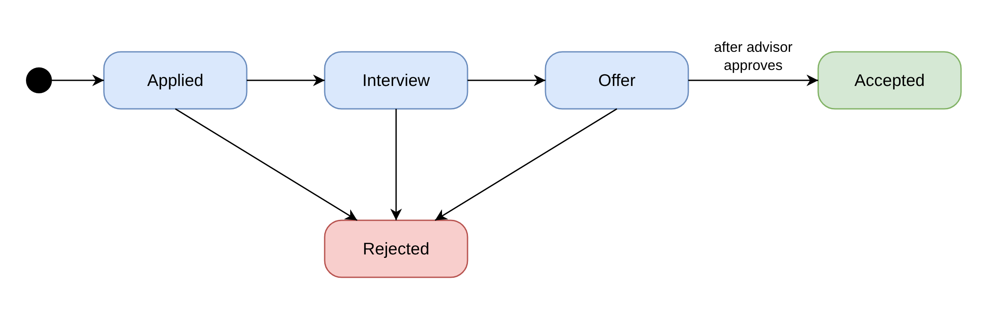

# SPEC: Student Internship Tracker

Students record their internship applications; advisors follow them, comment and approve offers.
The full proposal, with the data model and API overview, is in [`../PROPOSAL.md`](../PROPOSAL.md).

## Roles

| Role    | Who                                       | Can do                                                                                                       |
| ------- | ----------------------------------------- | ------------------------------------------------------------------------------------------------------------ |
| Student | An I4 student looking for an internship   | Register, log in, manage only their own applications, upload a CV, read comments, accept an approved offer |
| Advisor | A teacher who follows a group of students | Log in, see the applications of their assigned students, comment, approve an offer                         |

Advisor accounts come from the seed data. Public registration always creates a Student.

## Status workflow

`Applied → Interview → Offer → Accepted`, and `Rejected` from any active status (Applied, Interview, Offer).
An application only moves forward. Offer → Accepted needs the advisor's approval first.
Accepted and Rejected are final: the record is locked.

The data model is drawn in [`diagrams/er-diagram.png`](diagrams/er-diagram.png).

## User stories

Each story's status is updated at every check: **Not done** or **Done**.

### Student

**US-01 · Register and log in** · Status: Not done
As a student, I want to create an account and log in, so that only I can see my applications.

- Registering with a new email and a password of at least 8 characters creates a Student account
- Registering with an email already in use shows "Email is already registered"
- Logging in with a wrong password shows "Invalid email or password" and does not say which one is wrong
- After login I land on my applications list; after logout, protected pages send me to the login page

**US-02 · Add an application** · Status: Not done
As a student, I want to add an internship I applied for, so that I keep track of it.

- Company, position and date applied are required; status starts at Applied
- A missing company or position shows "Company is required" / "Position is required" under the field
- A date in the future shows "Date applied cannot be in the future"
- I cannot have more than 5 active applications; the 6th shows "You already have 5 active applications"

**US-03 · See my applications** · Status: Not done
As a student, I want to see a list of my applications, so that I know where I stand.

- The list shows company, position, date applied and status, newest first
- I see only my own applications, never another student's
- Opening another student's application by its URL shows "Application not found"

**US-04 · Search, filter and page through my applications** · Status: Not done
As a student, I want to search and filter my list, so that I find an application quickly.

- Typing in the search box filters by company or position (not case-sensitive)
- A status filter shows only applications with that status
- The list shows 10 applications per page with Previous / Next buttons

**US-05 · Edit or delete an application** · Status: Not done
As a student, I want to update an application's details and status, so that it stays current.

- I can edit company, position, date and notes, and move the status one step forward (Applied → Interview → Offer) or to Rejected; Accepted is set only through US-07
- Moving the status backward shows "Status can only move forward"
- An accepted or rejected application cannot be edited or deleted, and an approved offer can only be accepted or rejected; the buttons are hidden and the API returns 403
- Deleting asks for confirmation and removes the application and its comments

**US-06 · Upload my CV** · Status: Not done
As a student, I want to attach the CV I sent to an application, so that my advisor can review it.

- Only PDF files up to 2 MB are accepted
- Another file type shows "Only PDF files are allowed"; a larger file shows "File must be 2 MB or smaller"
- Uploading again replaces the previous CV; my advisor and I can download it

**US-07 · Accept an approved offer** · Status: Not done
As a student, I want to accept an offer after my advisor approves it, so that my internship is confirmed.

- The Accept button appears only when status is Offer and the advisor has approved it
- Accepting before approval returns 403 and shows "Your advisor must approve this offer first"
- After accepting, status is Accepted and the record is locked

### Advisor

**US-08 · See my students' applications** · Status: Not done
As an advisor, I want to see the applications of the students I follow, so that I know who needs help.

- The list shows student name, company, position and status, with the same search, filter and pagination as US-04
- I see only my assigned students; another advisor's student's application shows "Application not found"
- I cannot create, edit or delete applications (no buttons; the API returns 403)

**US-09 · Comment on an application** · Status: Not done
As an advisor, I want to comment on an application, so that the student gets feedback.

- A comment is 1–500 characters; an empty comment shows "Comment cannot be empty"
- Comments show author name and date, oldest first
- The student can read comments on their own applications and add their own

**US-10 · Approve an offer** · Status: Not done
As an advisor, I want to approve a student's offer, so that they accept only suitable internships.

- The Approve button appears only when status is Offer
- Approving records my name and the date on the application
- A student calling the approve endpoint gets 403

## Business rules

| ID   | Rule                                                                                                                | Error                                                             |
| ---- | ------------------------------------------------------------------------------------------------------------------- | ----------------------------------------------------------------- |
| BR-1 | A student can have at most **5 active applications** (Applied, Interview or Offer)                                  | 400 "You already have 5 active applications"                      |
| BR-2 | Status moves one step forward or to Rejected from any active status; Accepted is set only by the accept endpoint    | 400 "Status can only move forward"                                |
| BR-3 | Offer → Accepted only after an advisor approves the offer                                                           | 403 "Your advisor must approve this offer first"                  |
| BR-4 | An accepted or rejected application cannot be edited or deleted; an approved offer can only be accepted or rejected | 403 "This application is locked"                                  |
| BR-5 | Date applied cannot be in the future                                                                                | 400 "Date applied cannot be in the future"                        |
| BR-6 | CV must be a PDF of 2 MB or less                                                                                    | 400 "Only PDF files are allowed" / "File must be 2 MB or smaller" |
| BR-7 | A user can only read applications they own (student) or follow (advisor)                                            | 404 "Application not found"                                       |

## Guard table

**401** = no or invalid token. **403** = logged in with the wrong role or rule. **404** = the record is not yours.

| Action                     | No token | Student                            | Advisor                         |
| -------------------------- | -------- | ---------------------------------- | ------------------------------- |
| Register, log in           | Allowed  | Allowed                            | Allowed                         |
| List applications          | 401      | Own only                           | Assigned students only          |
| View one application       | 401      | Own, else 404                      | Assigned students, else 404     |
| Create application         | 401      | Allowed                            | 403                             |
| Edit or delete application | 401      | Own and not locked, else 403 / 404 | 403                             |
| Upload CV                  | 401      | Own and not locked                 | 403                             |
| Download CV                | 401      | Own                                | Assigned students               |
| Comment                    | 401      | Own applications                   | Assigned students' applications |
| Approve offer              | 401      | 403                                | Assigned students, status Offer |
| Accept offer               | 401      | Own, after approval                | 403                             |

## Screens

Wireframes for each screen are in [`wireframes/`](wireframes/README.md).

| Screen                  | Route (from Check 2)                      | Role             | Stories             |
| ----------------------- | ----------------------------------------- | ---------------- | ------------------- |
| Login                   | /login                                    | All              | US-01               |
| Register                | /register                                 | Public           | US-01               |
| My applications         | /applications                             | Student          | US-03, US-04        |
| Application detail      | /applications/:id                         | Student, Advisor | US-07, US-09, US-10 |
| Add or edit application | /applications/new, /applications/:id/edit | Student          | US-02, US-05, US-06 |
| Students' applications  | /advisor/applications                     | Advisor          | US-08               |
| Profile                 | /profile                                  | All              | –                   |
| Not found               | `/:pathMatch(.*)*`                        | All              | –                   |
