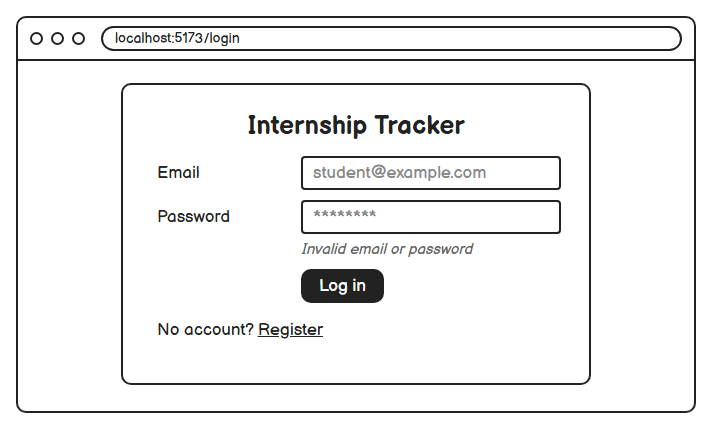
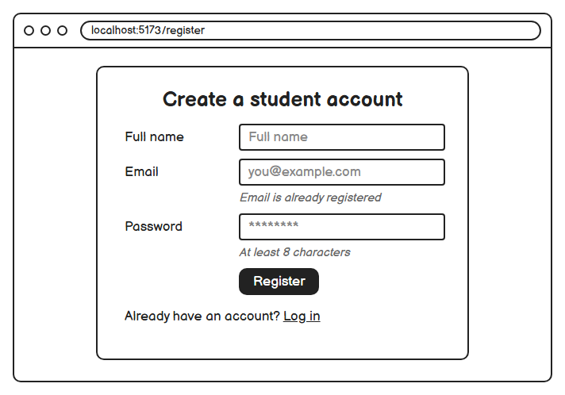
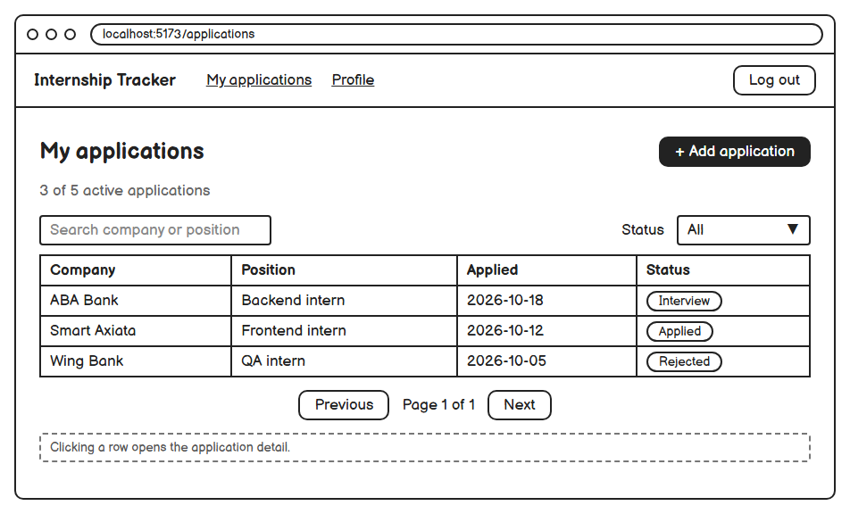
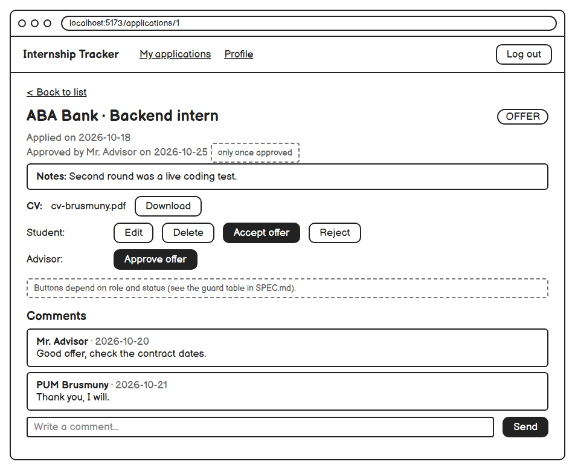
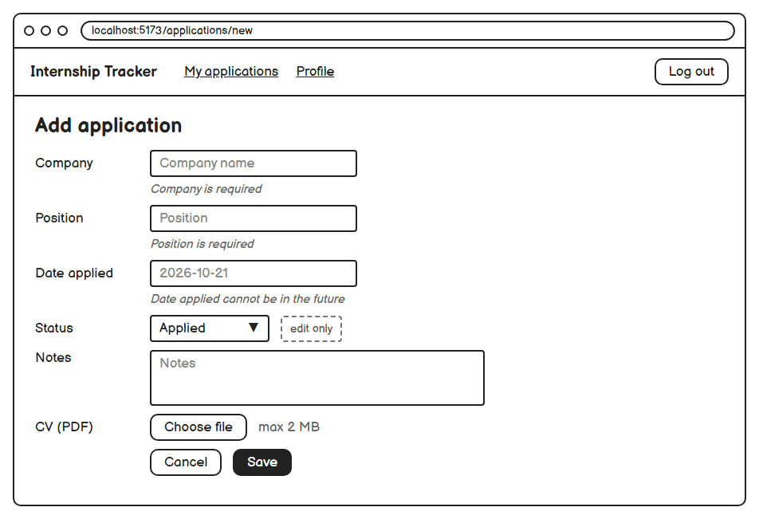
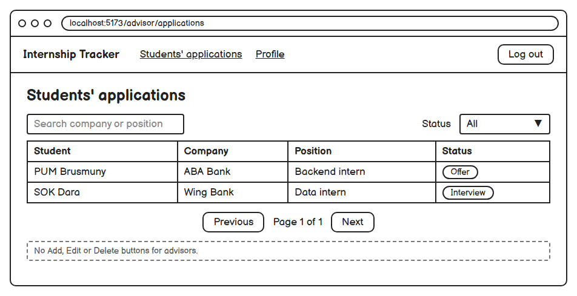
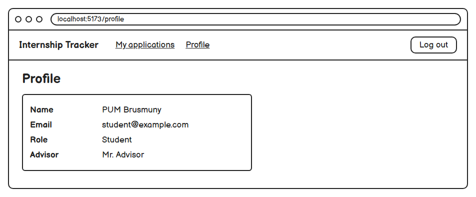
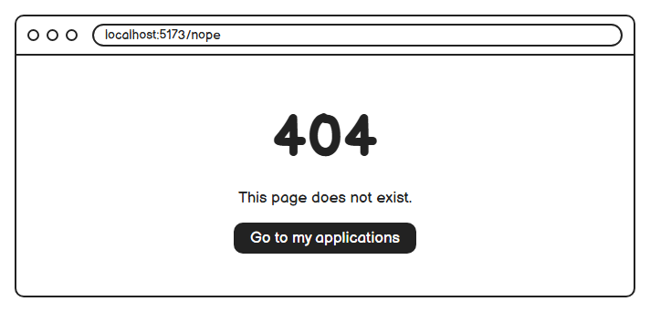

# Wireframes

Low-fidelity wireframes (Balsamiq style, no colour) for the main screens in [`../SPEC.md`](../SPEC.md). Each one lists the stories it serves.
A black button is the main action; a dashed box is a note, not part of the screen.

## 1. Login · US-01

## 2. Register · US-01

## 3. My applications (student) · US-03, US-04

A row opens the application detail.

## 4. Application detail · US-05, US-06, US-07, US-09, US-10

Buttons depend on role and status (see the guard table in SPEC.md).

## 5. Add or edit application · US-02, US-05, US-06

## 6. Students' applications (advisor) · US-08

No Add, Edit or Delete buttons for advisors.

## 7. Profile

## 8. Not found

